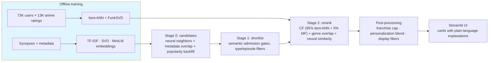

# MARS — My Anime Recommendation System

MARS recommends anime from a 13,000-title catalog by blending collaborative filtering
(item-kNN + matrix factorization) with synopsis embeddings and metadata, and every card says in
plain words why it was picked. Pick a title you like, or load a demo taste profile, and it ranks
the whole catalog in a few seconds.

[](https://myanimerecommendationsystem-x6rqm6vqjmbr2ij8i8yk3b.streamlit.app)

[](https://codecov.io/gh/daedwards06/MyAnimeRecommendationSystem)

> The live demo sleeps after a period of inactivity; the first load wakes it and takes ~10–20 seconds.


*Still image, if the GIF does not load: [app/assets/demo_screenshot.png](app/assets/demo_screenshot.png).*

## Results

Offline ranking quality over the **full catalog**, one cohort (1,000 users, seed 42, K=10), with
collaborative models fit on the train split only. Intervals are bootstrap over users.

| Model | NDCG@10 | NDCG@10 95% CI | MAP@10 | Coverage@10 | Gini@10 | NDCG vs. popularity |
|:---|---:|:---:|---:|---:|---:|---:|
| **Hybrid (weighted, re-tuned; served)** | **0.0658** | [0.0535, 0.0795] | **0.0521** | 0.1029 | 0.7596 | **+90%** |
| Item-kNN | 0.0628 | [0.0503, 0.0767] | 0.0513 | 0.1160 | 0.7280 | +81% |
| Hybrid (RRF rank fusion) | 0.0586 | [0.0475, 0.0713] | 0.0456 | 0.0784 | 0.8253 | +69% |
| Popularity baseline | 0.0347 | [0.0259, 0.0444] | 0.0255 | 0.0056 | 0.7175 | (baseline) |
| MF (FunkSVD) | 0.0326 | [0.0229, 0.0428] | 0.0266 | 0.0668 | 0.7875 | −6% |
| Hybrid (weighted, previous config weights) | 0.0324 | [0.0237, 0.0424] | 0.0249 | 0.0615 | 0.7993 | −7% |
| Content-only (TF-IDF) | 0.0211 | [0.0138, 0.0288] | 0.0166 | 0.1711 | 0.6334 | −39% |
| Content-only (embeddings) | 0.0101 | [0.0059, 0.0154] | 0.0069 | 0.0588 | 0.8620 | −71% |

The served blend beats popularity (+0.031, CI [+0.017, +0.045]) but is tied with item-kNN alone
(+0.003, CI [−0.003, +0.010]), and matrix factorization on its own is tied with popularity
(−0.002, CI [−0.014, +0.010]); protocol and caveats are in the
[evaluation report](reports/phase4_evaluation.md) and the [model card](docs/MODEL_CARD.md#metrics).

## How it works



Item-kNN is scored per request from the seed titles, or from the profile's ratings in *For me*
mode. Weights and thresholds live in [`src/app/constants.py`](src/app/constants.py); the stages
are described in the [scoring pipeline guide](docs/scoring_pipeline_integration_guide.md).

## What was hard / what I learned

- **An evaluation bug hid the best model.** Item-kNN first scored near zero because the
  offline harness masked "already seen" items using the model's own full-fit matrix, which
  contains the held-out item. Fixing it made kNN the strongest single model, and the blend had
  to be re-tuned on users disjoint from the reporting cohort, which roughly doubled its NDCG
  (0.0324 → 0.0658). The weights the old sweep chose had been fit to a broken signal.
- **Matrix factorization does not beat popularity.** FunkSVD is trained to minimize rating
  error, not to rank the full catalog, and on this protocol it is statistically tied with the
  popularity baseline. It stays in the blend at 5% for coverage; diagnosing it properly is the
  next piece of work.
- **Coverage and accuracy pull apart.** Popularity's top-10 lists cover 0.0056 of the catalog
  and TF-IDF content similarity's cover 0.1711, yet TF-IDF ranks below popularity on NDCG. The
  *Diversity* preset serves item-kNN alone because it ties the blend on accuracy with higher
  coverage (0.1160 vs. 0.1029).
- **There are no real timestamps.** The rating snapshot has no interaction dates, so the
  "temporal" split is built from row order and is reported as a heuristic only. A true
  time-aware evaluation needs a different dataset.
- **The pipeline still has hand-tuned gates.** Stage 1 admission thresholds and the obscurity
  penalty were set by hand against golden-query reports, not learned. They are all in one constants file
  and env-overridable, but only the CF blend weights are tuned against an offline metric.

## Quick Start

```bash
git clone https://github.com/daedwards06/MyAnimeRecommendationSystem.git
cd MyAnimeRecommendationSystem
python -m venv .venv && .venv\Scripts\activate  # Windows
pip install -r requirements.txt
streamlit run app/main.py
```

The app loads with a default seed and shows recommendations immediately. It runs from the
processed parquets committed to the repo and the Git LFS model artifacts; raw data is only needed
to retrain (see [`data/README.md`](data/README.md)). To use your own ratings, import a
[MyAnimeList export](https://myanimelist.net/panel.php?go=export) in *For me* mode — see the
[personalization guide](docs/user_guide_personalization.md).

## Links

- [Documentation index](docs/index.md) — every report and guide, including the
  [catalog refresh](docs/data_catalog.md#updating-the-catalog) and the
  [project structure and tech stack](docs/project_structure.md)
- [Model card](docs/MODEL_CARD.md) — intended use, data, metrics, limitations
- [Evaluation report](reports/phase4_evaluation.md) and [ablation table](reports/phase4_ablation.md)
- [Deployment notes](docs/DEPLOYMENT.md)
