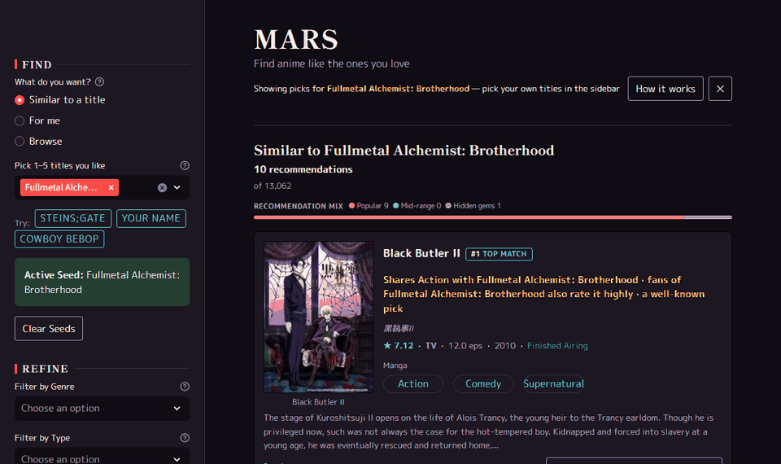
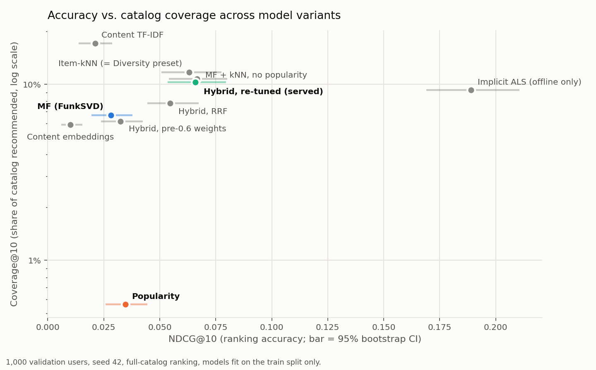
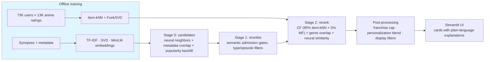

# MARS — My Anime Recommendation System

MARS recommends anime from a 13,000-title catalog by blending collaborative filtering
(item-kNN + matrix factorization) with synopsis embeddings and metadata, and every card says in
plain words why it was picked. Pick a title you like, or load a demo taste profile, and it ranks
the whole catalog in a few seconds. [Read the write-up](docs/WRITEUP.md) for how it was built,
what went wrong, and how each mistake was caught.

[](https://myanimerecommendationsystem-x6rqm6vqjmbr2ij8i8yk3b.streamlit.app)

[](https://codecov.io/gh/daedwards06/MyAnimeRecommendationSystem)

> The live demo is kept awake by a scheduled visit, and the first recommendations appear in about 11 seconds. If you ever find it asleep, click the wake-up button; it reloads its models before showing results, so that first load takes longer.



*Still image, if the GIF does not load: [app/assets/demo_screenshot.png](app/assets/demo_screenshot.png).*

## Results



*NDCG@10 (with its 95% bootstrap CI) against the share of the catalog each variant recommends, on
one cohort: 1,000 validation users, seed 42, full-catalog ranking. Popularity ties MF on accuracy
but shows everyone the same 0.6% of the catalog; content similarity spreads wide but ranks poorly;
item-kNN and the blends built on it beat both on both axes; implicit ALS, evaluated offline and not yet
served, is about three times more accurate than anything else. NDCG@K at K = 5, 10, 20: [ablation_ndcg_at_k.png](reports/figures/ablation_ndcg_at_k.png).*

Offline ranking quality over the **full catalog**, one cohort (1,000 users, seed 42, K=10), with
collaborative models fit on the train split only. Intervals are bootstrap over users.

| Model | NDCG@10 | NDCG@10 95% CI | MAP@10 | Coverage@10 | Gini@10 | NDCG vs. popularity |
|:---|---:|:---:|---:|---:|---:|---:|
| Implicit ALS (offline only, not served) | 0.1890 | [0.1691, 0.2106] | 0.1516 | 0.0927 | 0.6542 | +445% |
| MF + kNN, no popularity | 0.0667 | [0.0540, 0.0802] | 0.0529 | 0.1076 | 0.7507 | +92% |
| **Hybrid (weighted, re-tuned; served)** | **0.0658** | [0.0535, 0.0795] | **0.0521** | 0.1029 | 0.7601 | **+90%** |
| Item-kNN | 0.0632 | [0.0507, 0.0775] | 0.0516 | 0.1168 | 0.7276 | +82% |
| Hybrid (RRF rank fusion) | 0.0547 | [0.0445, 0.0674] | 0.0419 | 0.0782 | 0.8281 | +58% |
| Popularity baseline | 0.0347 | [0.0259, 0.0444] | 0.0255 | 0.0056 | 0.7175 | (baseline) |
| Hybrid (weighted, previous config weights) | 0.0324 | [0.0237, 0.0424] | 0.0249 | 0.0615 | 0.7993 | −7% |
| MF (FunkSVD) | 0.0282 | [0.0196, 0.0379] | 0.0224 | 0.0667 | 0.7910 | −19% |
| Content-only (TF-IDF) | 0.0211 | [0.0138, 0.0288] | 0.0166 | 0.1711 | 0.6334 | −39% |
| Content-only (embeddings) | 0.0101 | [0.0059, 0.0154] | 0.0069 | 0.0588 | 0.8620 | −71% |

The served blend beats popularity (+0.031, CI [+0.017, +0.045]) but is tied with item-kNN alone
(+0.003, CI [−0.004, +0.009]), and matrix factorization on its own is tied with popularity
(−0.006, CI [−0.017, +0.005]). Removing the popularity term from the blend changes nothing
measurable. Protocol and caveats are in the
[evaluation report](reports/phase4_evaluation.md) and the [model card](docs/MODEL_CARD.md#metrics).

## How it works



Item-kNN is scored per request from the seed titles, or from the profile's ratings in *For me*
mode. Weights and thresholds live in [`src/app/constants.py`](src/app/constants.py); the stages
are described in the [scoring pipeline guide](docs/scoring_pipeline_integration_guide.md).

## What was hard / what I learned

- **An evaluation bug hid the best model.** Item-kNN first scored near zero because the
  offline harness masked "already seen" items using the model's own full-fit matrix, which
  contains the held-out item. Fixing it made kNN the strongest single model, and the blend had
  to be re-tuned on users disjoint from the reporting cohort, which roughly doubled its NDCG
  (0.0324 → 0.0658). The weights the old sweep chose had been fit to a broken signal.
- **Matrix factorization learned the wrong thing.** FunkSVD fits ratings, and 19% of this
  dataset's ratings are a "watched, not rated" code that cleaning turned into 0. So it learned that
  a large share of what people watch is worthless. It ranks those held-out titles near the bottom
  of the catalog and ties the popularity baseline overall. Dropping the zeros makes it worse. An
  implicit-feedback ALS trained on watched / not watched scores NDCG@10 0.1890 against
  FunkSVD's 0.0282 ([MF diagnostic](reports/mf_diagnostic.md)). The same diagnosis turned up two
  smaller evaluation faults, both fixed: MF scored users it had never seen with an accidental
  popularity fallback, and kNN's seen-mask let 0-rated titles through. It also showed that an
  earlier small-slice test which found the train/test leak harmless was wrong at full scale.
- **Learning the weights only paid off with new signals.** A LightGBM LambdaRank reranker over the
  blend's top 200 ties the tuned blend when it sees only the three CF scores (0.0683 vs. 0.0658). It
  beats it when it also gets the content and metadata affinities: 0.0931 over three seeds, every
  paired CI above zero ([learned reranker](reports/learned_reranker.md)). It ships behind
  `RERANKER_MODE=learned`, off by default.
- **The blend's edge over item-kNN is a fallback.** Broken out by user segment
  ([segment notebook](notebooks/03_segment_and_error_analysis.ipynb)), the served blend beats
  item-kNN only for the least active quarter of users (+0.0170 NDCG@10, paired CI above zero) and
  ties it on every user kNN can score. Offline kNN returns no list for 113 of the 1,000 cohort
  users (no history, or every rating identical, which leaves a zero profile), and the blend's MF and
  popularity terms quietly rank for them. That fallback was never designed; making it explicit is
  one of the next steps the notebook lists.
- **Coverage and accuracy pull apart.** Popularity's top-10 lists cover 0.0056 of the catalog
  and TF-IDF content similarity's cover 0.1711, yet TF-IDF ranks below popularity on NDCG. The
  *Diversity* preset serves item-kNN alone because it ties the blend on accuracy with higher
  coverage (0.1168 vs. 0.1029).
- **There are no real timestamps.** The rating snapshot has no interaction dates, so the
  "temporal" split is built from row order and is reported as a heuristic only. A true
  time-aware evaluation needs a different dataset.
- **The pipeline still has hand-tuned gates.** Stage 1 admission thresholds and the obscurity
  penalty were set by hand against golden-query reports, not learned. They are all in one constants file
  and env-overridable, but only the CF blend weights are tuned against an offline metric.

## Quick Start

```bash
git clone https://github.com/daedwards06/MyAnimeRecommendationSystem.git
cd MyAnimeRecommendationSystem
python -m venv .venv && .venv\Scripts\activate  # Windows
pip install -r requirements.txt
streamlit run app/main.py
```

The app loads with a default seed and shows recommendations immediately. It runs from the
processed parquets committed to the repo and the Git LFS model artifacts; raw data is only needed
to retrain (see [`data/README.md`](data/README.md)). To use your own ratings, import a
[MyAnimeList export](https://myanimelist.net/panel.php?go=export) in *For me* mode — see the
[personalization guide](docs/user_guide_personalization.md).

## Links

- [Documentation index](docs/index.md) — every report and guide, including the
  [catalog refresh](docs/data_catalog.md#updating-the-catalog) and the
  [project structure and tech stack](docs/project_structure.md)
- [Model card](docs/MODEL_CARD.md) — intended use, data, metrics, limitations
- [Evaluation report](reports/phase4_evaluation.md) and [ablation table](reports/phase4_ablation.md)
- [Deployment notes](docs/DEPLOYMENT.md)
