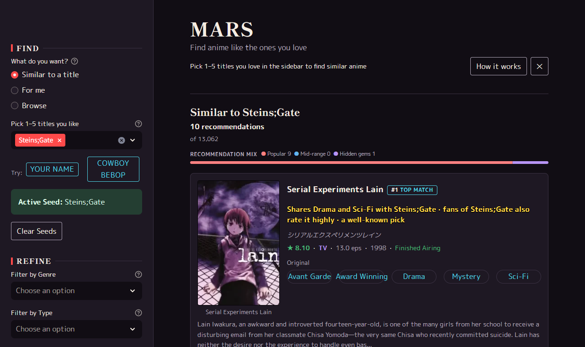
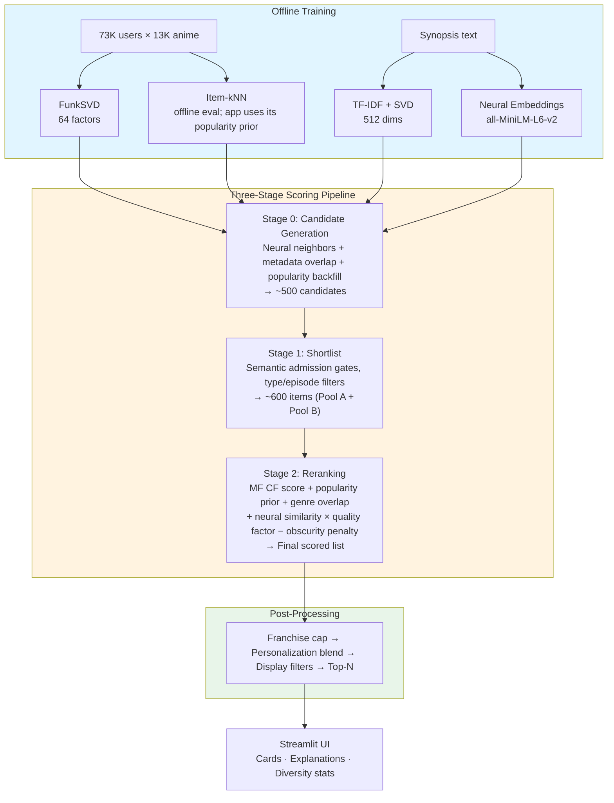

# MARS — My Anime Recommendation System


[](https://codecov.io/gh/daedwards06/MyAnimeRecommendationSystem)
[](https://myanimerecommendationsystem-x6rqm6vqjmbr2ij8i8yk3b.streamlit.app)

> The live demo sleeps after a period of inactivity; the first load wakes it and takes ~10–20 seconds.

A **hybrid recommendation engine** that combines collaborative filtering, content-based similarity, and neural embeddings to recommend anime from a catalog of 13,000+ titles. Built with a three-stage scoring pipeline (candidate generation → shortlist → reranking), a Streamlit UI with explainable results, and ~290 automated tests.

<!-- To update: run the app (streamlit run app/main.py), search for a popular title, take a screenshot, save to app/assets/demo_screenshot.png -->

*Seed-based recommendations for Steins;Gate showing match scores, signal explanations, and metadata cards.*

---

## Key Features

- **Three-stage ranking pipeline** — candidate generation (neural + metadata + popularity pools), semantic shortlisting, hybrid reranking with 10+ scoring signals
- **Collaborative filtering** — FunkSVD matrix factorization with a popularity prior in the app; item-kNN and a re-tuned kNN-led blend evaluated offline (see Results), trained on 73K users and 310K+ ratings
- **Multi-modal content signals** — TF-IDF, SVD embeddings, and neural sentence embeddings (all-MiniLM-L6-v2) for synopsis-level semantic matching
- **Personalization** — import your MyAnimeList profile; blend seed-based and CF-based recommendations 0–100% with a slider
- **Explainability** — every recommendation shows signal breakdown (CF / Content / Popularity shares), genre overlap, and match confidence
- **Diversity controls** — franchise capping, configurable quality factor modes, coverage and Gini tracking

## Results

All evaluations rank over the **full 13K-item catalog** (no pre-filtered shortlist), from a single
run: 1,000 sampled users, `seed=42`, K=10. Collaborative-filtering models are fit on the **train
split only** — the artifacts the app serves are fit on every interaction, including the held-out
rows, so scoring them offline measures leakage rather than quality. See
[`reports/phase4_evaluation.md`](reports/phase4_evaluation.md) and the
[model card](docs/MODEL_CARD.md#metrics) for protocol, caveats, and the full narrative.

### Ablation (K=10, 1,000 users, seed 42)

| Model | NDCG@10 | NDCG@10 95% CI | MAP@10 | Coverage@10 | Gini@10 | NDCG vs. popularity |
|:---|---:|:---:|---:|---:|---:|---:|
| **Hybrid (weighted, re-tuned)** | **0.0658** | [0.0535, 0.0795] | **0.0521** | 0.1029 | 0.7596 | **+90%** |
| Item-kNN | 0.0628 | [0.0503, 0.0767] | 0.0513 | 0.1160 | 0.7280 | +81% |
| Hybrid (RRF rank fusion) | 0.0586 | [0.0475, 0.0713] | 0.0456 | 0.0784 | 0.8253 | +69% |
| Popularity baseline | 0.0347 | [0.0259, 0.0444] | 0.0255 | 0.0056 | 0.7175 | (baseline) |
| MF (FunkSVD) | 0.0326 | [0.0229, 0.0428] | 0.0266 | 0.0668 | 0.7875 | −6% |
| Hybrid (weighted, current config weights) | 0.0324 | [0.0237, 0.0424] | 0.0249 | 0.0615 | 0.7993 | −7% |
| Content-only (TF-IDF) | 0.0211 | [0.0138, 0.0288] | 0.0166 | 0.1711 | 0.6334 | −39% |
| Content-only (embeddings) | 0.0101 | [0.0059, 0.0154] | 0.0069 | 0.0588 | 0.8620 | −71% |

Intervals are percentile bootstrap over users (1,000 resamples). Comparisons below use *paired*
intervals on the NDCG difference, because every model is scored on the same users.

- **Collaborative filtering with item-kNN works; MF on its own does not beat popularity.** The
  re-tuned blend, item-kNN alone and RRF all beat popularity (re-tuned blend +0.031,
  CI [+0.017, +0.045]) and MF. MF and popularity are statistically tied
  (−0.002, CI [−0.014, +0.010]), as are MF and the blend with the current config weights.
- **Re-tuning roughly doubled the blend's NDCG** (0.0324 → 0.0658). The config weights
  (93% MF / 7% kNN) came from a sweep run while kNN could not score, on users that overlapped the ones the
  report scores. The new sweep tunes on 1,000 users disjoint from this cohort. The weights the
  sweep picked are 95% kNN / 5% MF, and the result is **tied with item-kNN alone**
  (+0.003, CI [−0.003, +0.010]).
- **The app does not serve the re-tuned blend yet.** Its CF signal today is MF plus a popularity
  prior; the kNN model is not wired into app scoring, so swapping the weights would not reproduce
  this ranking. Wiring kNN in is the next model change, and the reason is recorded in
  [`docs/decisions.md`](docs/decisions.md).

Reproduce with:

```bash
python scripts/run_unified_eval.py --k 10 --sample-users 1000
python scripts/aggregate_phase4_metrics.py --cohort 1000
python scripts/generate_phase4_ablation.py
```

## Architecture



## Quick Start

```bash
git clone https://github.com/daedwards06/MyAnimeRecommendationSystem.git
cd MyAnimeRecommendationSystem
python -m venv .venv && .venv\Scripts\activate  # Windows
pip install -r requirements.txt
streamlit run app/main.py
```

The app loads with a default seed and shows recommendations immediately — no setup needed. It
runs from the processed parquets committed to the repo; the raw Kaggle CSVs are not tracked.

**Optional — fetch raw data for retraining:** only needed to rebuild features or retrain models
(`scripts/build_features.py`, `scripts/refresh_catalog.py`), not to run the app.

```bash
pip install kaggle && export KAGGLE_USERNAME=... KAGGLE_KEY=...
python scripts/download_data.py --dry-run   # show the plan
python scripts/download_data.py             # download, extract, verify row counts
```

See [`data/README.md`](data/README.md) for the full data layout and which files are tracked.

**Optional — Personalization:** Import your [MyAnimeList export](https://myanimelist.net/panel.php?go=export) via the sidebar to get CF-based recommendations from your own ratings. The app shows inline export instructions right next to the upload widget. See [`docs/user_guide_personalization.md`](docs/user_guide_personalization.md) for the full walkthrough.

## Updating the Anime Catalog

The catalog ships with 13,000+ titles. To add newly aired anime (e.g., a new season's premieres):

```bash
# Full refresh — discover new IDs from Jikan, fetch metadata, rebuild all artifacts:
python scripts/refresh_catalog.py

# Or target a specific season:
python scripts/refresh_catalog.py --season 2026 winter

# Makefile shortcuts:
make refresh-all
make refresh-season YEAR=2026 SEASON=winter
```

The refresh pipeline runs 7 steps automatically: discover → fetch metadata → build features → synopsis TF-IDF → synopsis embeddings → retrain CF models → enrich images. Use `--skip-models`, `--skip-synopsis`, or `--skip-images` to skip expensive steps. See [`docs/data_catalog.md`](docs/data_catalog.md) for the full data lineage.

## Project Structure

```
├── app/main.py                  # Streamlit entry point (UI lives in src/app/components/)
├── src/
│   ├── app/
│   │   ├── scoring_pipeline.py  # Pure-Python 3-stage pipeline (~2,000 lines)
│   │   ├── artifacts_loader.py  # Model loading + validation
│   │   ├── constants.py         # All scoring weights & thresholds
│   │   ├── recommender.py       # Hybrid CF blending
│   │   ├── stage0_candidates.py # Candidate generation
│   │   ├── stage1_shortlist.py  # Shortlist construction
│   │   └── components/          # Card rendering, explanations, diversity panel
│   ├── models/                  # FunkSVD, kNN, content similarity, user embeddings
│   ├── eval/                    # Metrics (NDCG, MAP, coverage, Gini, graded relevance)
│   ├── features/                # Feature engineering, embeddings, scaling
│   └── data/                    # Data loading, MAL parser, user profiles
├── scripts/
│   ├── refresh_catalog.py       # End-to-end catalog refresh (discover → retrain)
│   ├── fetch_jikan.py           # Fetch metadata from Jikan API
│   ├── discover_new_ids.py      # Find new MAL IDs missing from catalog
│   ├── build_features.py        # Feature engineering orchestrator
│   └── save_artifacts.py        # Retrain CF models (--split full serves, --split train evaluates)
├── tests/                       # ~290 tests
├── reports/                     # Evaluation reports, ablation studies
├── models/                      # Trained model artifacts (.joblib, gitignored)
└── data/                        # Processed parquets + samples tracked; image & Jikan caches gitignored
```

## Tech Stack

**ML/Data:** NumPy, pandas, scikit-learn, Optuna | **Embeddings:** sentence-transformers (all-MiniLM-L6-v2, optional — offline build only) | **App:** Streamlit | **Search:** RapidFuzz | **CI:** GitHub Actions, pytest

## Documentation

| Topic | Link |
|-------|------|
| **Deployment to Streamlit Cloud** | [`docs/DEPLOYMENT.md`](docs/DEPLOYMENT.md) |
| Evaluation & ablation | [`reports/phase4_evaluation.md`](reports/phase4_evaluation.md) |
| Model card | [`docs/MODEL_CARD.md`](docs/MODEL_CARD.md) |
| Personalization guide | [`docs/user_guide_personalization.md`](docs/user_guide_personalization.md) |
| Watchlist import | [`docs/user_guide_watchlist.md`](docs/user_guide_watchlist.md) |
| Data catalog | [`docs/data_catalog.md`](docs/data_catalog.md) |
| Scoring pipeline design | [`docs/scoring_pipeline_integration_guide.md`](docs/scoring_pipeline_integration_guide.md) |
| Data sources & licensing | [`docs/DATA_SOURCES.md`](docs/DATA_SOURCES.md) |
