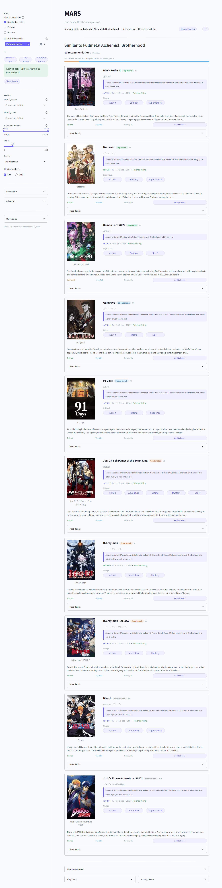
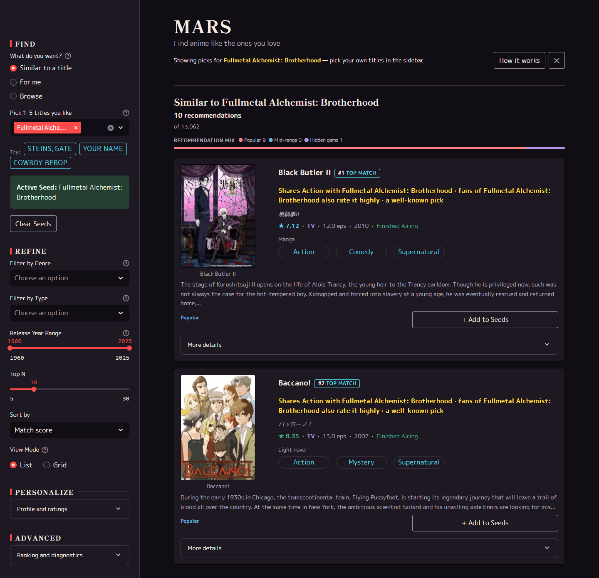

# UI Design

The Streamlit app was redesigned in October 2026 as a late-90s anime broadcast: a plum-black
"Signal OVA" palette, Shippori Mincho titles, and each card's plain-language explanation set like
a VHS fansub subtitle. The plan was [MARS_UI_REDESIGN_PLAN.md](plans/MARS_UI_REDESIGN_PLAN.md);
why this direction and what was ruled out are in the [decision log](decisions.md) (2026-10-19 and
2026-10-20 entries).

## Where the design lives

| Source | What it holds |
|--------|---------------|
| [design-system/mars/MASTER.md](../design-system/mars/MASTER.md) | The design system: direction, the 90s overrides, type, UX rules, anti-patterns, pre-delivery checklist |
| [src/app/theme_tokens.py](../src/app/theme_tokens.py) | The only source for colors, fonts, spacing, radii. `scripts/build_theme.py` generates `.streamlit/config.toml` `[theme]` and `app/styles/tokens.css` from it; `tests/test_theme_tokens.py` fails if either drifts or a text pair drops below 4.5:1 |
| [app/styles/](../app/styles/) | All app CSS, injected once from `app/main.py` |

## Before and after

Seed-based mode at 1440×900, default seed (Fullmetal Alchemist: Brotherhood).

| Before (2026-10-19, Task 0.2) | After (2026-10-20, Task 4.2) |
|---|---|
|  |  |

The baseline is the full page; the after shot covers the first two cards. Every mode and the
phone width at baseline are in [redesign/baseline/](redesign/baseline/); intermediate sets are
`redesign/after_2_1/`, `after_2_2/` and `after_3_2/`.

## Redesign records

| Page | What it covers |
|------|----------------|
| [UX plan](redesign/UX_PLAN.md) | The first-five-minutes audit (F1–F18) and how each finding was closed, deferred or declined |
| [Style inventory](redesign/STYLE_INVENTORY.md) | Every style source before consolidation |
| [Skill search](redesign/SKILL_SEARCH.md) | Design-system queries and the shortlist |
| [Mockups](redesign/mockups/index.html) | The three intensities and palette/type toggles the direction was picked from |
| [Accessibility pass](redesign/A11Y_PASS.md) | Contrast, keyboard focus, screen-reader order, reduced motion |

The pre-redesign design notes (layout goals, imagery pipeline, UX backlog) are in git history
before this page's 2026-10-20 rewrite.
