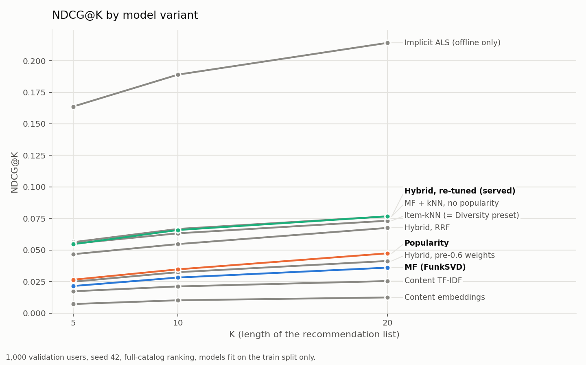

# Phase 4 Evaluation & Analysis

## 1. Overview
Phase 4 turns raw experiment outputs into portfolio-quality evaluation assets (curves, ablations,
explanations) and establishes CI quality gates prior to app integration.

### Protocol
Every number in §2–§4 comes from **one run**:
`scripts/run_unified_eval.py --k 10 --sample-users 1000 --variants all` (every variant at
K = 5, 10, 20), seed 42, ranking over the full ~13K-item catalog with no pre-filtered shortlist. The run writes
JSON to `experiments/metrics/`; `scripts/aggregate_phase4_metrics.py --cohort 1000` deduplicates it
to one row per (model, K) and `scripts/generate_phase4_ablation.py` renders the table. Mixing cohorts is
a hard error, because models scored on different user samples are not comparable.

**Artifacts.** Offline evaluation does **not** score the artifacts in `models/`. Those are fit on
the full interaction table, and `build_validation` carves the holdout out of that same table, so a
served artifact has already seen every validation pair it would be scored on. Evaluation fits its
own kNN and MF on the train split (`src/eval/eval_artifacts.py`, cached under
`experiments/artifacts/`). The served stems are recorded in each metrics JSON for traceability.

### Methodology & Definitions
- NDCG@K: Discounted gain of binary relevance normalized by ideal ordering.
- MAP@K: Mean user average precision across users truncated at K.
- Coverage@K: Fraction of catalog items appearing at least once in users' top-K.
- Gini@K: Inequality of item recommendation frequency (higher = more concentrated).
- Cold-Start: Items lacking rating history; scored via content-only similarity and popularity priors.
- Temporal Split: Heuristic chronological partition (synthetic timestamp used if missing).
- Reproducibility: Seed=42; static Kaggle ratings; enrichment snapshot `202511_full`.

## 2. Accuracy vs. Coverage

`scripts/plot_ablation_tradeoff.py`, from `reports/phase4_ablation.csv`. One point per variant at
K=10; the horizontal bar is the 95% bootstrap CI on NDCG@10, and coverage is on a log scale
because the variants span 0.56% (popularity) to 17% (TF-IDF) of the catalog. The app's Diversity
preset is item-kNN alone (`{knn: 1.0}`), so offline it *is* the item-kNN point rather than a
separate one.

The chart has three regions. Popularity sits at the bottom: tied with MF on accuracy, with a
tenth of anyone else's coverage. Content similarity sits top-left: wide coverage, low
accuracy. Item-kNN and every blend that leans on it cluster at roughly 0.06 NDCG and 10-12%
coverage, and the intervals inside that cluster overlap. Implicit ALS is alone on the right,
about three times the cluster's NDCG at slightly lower coverage.

## 3. Metric Curves Across K

Every variant at K = 5, 10 and 20 on the same cohort ("Across K" in
`reports/phase4_ablation.md`; every column, including MAP and the paired differences, in
`reports/phase4_ablation_by_k.csv`). The ordering is stable across K. Inside the kNN-led cluster
the three variants swap places within their intervals; the one paired difference there that
clears zero is the popularity-free blend over the served one at K = 5, by a hair (+0.0016, paired
CI [+0.0000, +0.0036]), and the two are tied at K = 10 and 20. MF falls further behind popularity as K grows: tied at K = 5 and
10, below it at K = 20 (−0.0113, paired CI [−0.0220, −0.0002], just clear of zero). Coverage grows
with K for every model. Popularity's Gini *falls* with K (0.747 → 0.688) only because its list
gets longer, not more varied: coverage@20 is still 0.89%.

Score-ranked lists are computed once at K = 20 and truncated, so each top-K is a prefix of the
top-20. RRF is the exception: it fuses each source's top-K, so it is rebuilt at every K.

## 4. Ablation (K=10)

Generated by `scripts/generate_phase4_ablation.py` into `reports/phase4_ablation.{csv,md}`.
1,000 sampled users, seed 42, full-catalog ranking, train-split artifacts.

| Model | NDCG@10 | NDCG@10 95% CI | MAP@10 | Coverage@10 | Gini@10 | ΔNDCG vs. popularity, paired 95% CI | ΔNDCG vs. item-kNN, paired 95% CI |
|:---|---:|:---:|---:|---:|---:|:---:|:---:|
| implicit_als | 0.1890 | [0.1691, 0.2106] | 0.1516 | 0.0927 | 0.6542 | [+0.1340, +0.1750] | [+0.1059, +0.1475] |
| hybrid_mf_knn | 0.0667 | [0.0540, 0.0802] | 0.0529 | 0.1076 | 0.7507 | [+0.0184, +0.0465] | [−0.0027, +0.0096] |
| hybrid_weighted_tuned | 0.0658 | [0.0535, 0.0795] | 0.0521 | 0.1029 | 0.7601 | [+0.0175, +0.0454] | [−0.0036, +0.0091] |
| item_knn_sklearn | 0.0632 | [0.0507, 0.0775] | 0.0516 | 0.1168 | 0.7276 | [+0.0140, +0.0441] | — |
| hybrid_rrf | 0.0547 | [0.0445, 0.0674] | 0.0419 | 0.0782 | 0.8281 | [+0.0099, +0.0308] | [−0.0180, +0.0006] |
| popularity | 0.0347 | [0.0259, 0.0444] | 0.0255 | 0.0056 | 0.7175 | — | [−0.0441, −0.0140] |
| hybrid_weighted | 0.0324 | [0.0237, 0.0424] | 0.0249 | 0.0615 | 0.7993 | [−0.0129, +0.0086] | [−0.0447, −0.0188] |
| mf_sgd | 0.0282 | [0.0196, 0.0379] | 0.0224 | 0.0667 | 0.7910 | [−0.0171, +0.0046] | [−0.0485, −0.0234] |
| content_tfidf | 0.0211 | [0.0138, 0.0288] | 0.0166 | 0.1711 | 0.6334 | [−0.0260, −0.0014] | [−0.0566, −0.0289] |
| content_embeddings | 0.0101 | [0.0059, 0.0154] | 0.0069 | 0.0588 | 0.8620 | [−0.0352, −0.0148] | [−0.0681, −0.0396] |

Intervals are percentile bootstrap over users (1,000 resamples, seed 42); the Δ columns are
*paired*, resampling the same users for both models, which is the right test when every model is
scored on one cohort. An interval that spans zero is a tie. The CSV also carries the paired
difference against MF and the MAP intervals.

`hybrid_weighted` uses the weights the app served before Task 0.9 (mf 0.931, knn 0.066,
pop 0.003). `hybrid_weighted_tuned` uses the Task 0.6 re-tune (mf 0.048, knn 0.952, pop 0.0003),
now `DEFAULT_HYBRID_WEIGHTS` and the app's Balanced preset: 100 TPE trials on 1,000 validation
users **disjoint** from the reporting cohort.
`hybrid_rrf` is reciprocal rank fusion over the same three sources, which weights them by rank
position rather than by score magnitude.
`hybrid_mf_knn` is the re-tuned blend with its popularity term removed and MF/kNN renormalized
(mf 0.047 / knn 0.953): the leave-one-out test of the popularity term. `implicit_als` is the
implicit-feedback MF from Task 2.1 (`src/models/als_implicit.py`, alpha 5 tuned on users outside
this cohort), fit on the train split like the others; it is offline only and not served.

### What replaced the previous table
The earlier published ablation was ten rows all labeled `popularity`, spanning three cohort sizes,
and the README headline `+43% NDCG / +61% MAP` was popularity@500 measured against popularity@300 —
the baseline against itself. No hybrid lift had ever actually been published. See
`docs/decisions.md`, "The evaluation table is one cohort from one run", for the three compounding
faults and the guards now in place.

Numbers from before 2026-09-17 are **superseded, not comparable**: they were produced under the
leaky protocol and a different holdout sampler. The 2026-03-14 refresh of
`data/processed/interactions.parquet` did not change its rows (Task 2.1, `reports/mf_diagnostic.md`).

## 5. Hybrid Explanation Examples
Produced via `scripts/explain_hybrid_examples.py` -> `experiments/metrics/hybrid_explanations.json`.

Example (User 14593, Top-5 items component shares):

| Item ID | MF Score | kNN Score | Pop Score | MF Share | kNN Share | Pop Share | Total |
|---------|----------|-----------|-----------|----------|-----------|----------|-------|
| 918     | 8.2115   | 0.0096    | 0.2000    | 0.9751   | 0.0011    | 0.0237   | 8.4210 |
| 9969    | 8.2206   | 0.0082    | 0.1917    | 0.9763   | 0.0010    | 0.0228   | 8.4205 |
| 820     | 8.2097   | 0.0074    | 0.1689    | 0.9790   | 0.0009    | 0.0201   | 8.3860 |
| 32281   | 8.1645   | 0.0069    | 0.1923    | 0.9762   | 0.0008    | 0.0230   | 8.3637 |
| 19      | 8.1503   | 0.0145    | 0.1982    | 0.9746   | 0.0017    | 0.0237   | 8.3630 |

Observation: the MF term takes >97% of the blended score under the previous config weights (the
example above), and the kNN term contributes ~0.1%. Read alongside §4 and §8 this was the
problem, not a curiosity: those weights concentrated the blend on the weaker of the two CF models.
The examples predate the re-tune and have not been regenerated.

## 6. Temporal Robustness
Artifact: `reports/artifacts/temporal_split_comparison.json`

Synthetic temporal split (train_frac=0.7, timestamp_source="synthetic from row index"):

| Metric | Value |
|--------|-------|
| NDCG@5 | 0.4399 |
| NDCG@10 | 0.4383 |
| NDCG@20 | 0.4453 |
| MAP@5 | 0.1534 |
| MAP@10 | 0.0897 |
| MAP@20 | 0.0739 |
| Coverage@10 | 0.0018 |
| Gini@10 | 0.5000 |

**Caveat, and why this table is here rather than in the README.** The snapshot has no real
interaction dates, so this split approximates chronological order from *synthetic* timestamps
derived from row index. The resulting NDCG values are an order of magnitude above every
like-for-like measurement in §4, which is a sign of ordering artifacts rather than of a better
model. Coverage of 0.18% indicates severe concentration. Treat these as a heuristic robustness
check only; §4 is the defensible comparison, and these numbers were moved out of README § Results
so they cannot be read as a headline accuracy claim.

## 7. Content-Only and Cold-Start Performance
Content-only evaluation from the same 1,000-user run (full catalog, not restricted to new items):

| Model | NDCG@10 | MAP@10 | Coverage@10 |
|-------|---------|--------|-------------|
| TF-IDF Content | 0.0211 | 0.0166 | 0.1711 |
| Embeddings Content | 0.0101 | 0.0069 | 0.0588 |

TF-IDF features beat neural embeddings on this task by 2×, and TF-IDF has the **highest catalog
coverage of any model measured** (0.171, 30× popularity) — it is the weakest ranker and the
broadest one. That is the expected shape for a content signal and is why content contributes to
candidate generation rather than to final ordering.

The cold-start-restricted run (`scripts/evaluate_cold_start.py`, items with no rating history)
returned NDCG@10 = 0.0 at this cohort: no held-out item for any of the 1,000 sampled users was a
cold item, so the metric has no support here rather than reporting a model failure. Measuring
cold-start properly needs a cohort selected for cold items; that is open work.

## 8. Interpretation & Narrative

**Item-kNN is the strongest single model, and its previous near-zero score was a measurement bug.**
The published figure was NDCG@10 = 0.0017, roughly 30× below MF, and it was treated as a property
of the model. It was not. `ItemKNNRecommender.recommend(exclude_seen=True)` masks items using the
model's *own* stored user-item matrix. When the kNN artifact is fit on the full interaction table,
that matrix contains the held-out validation item, so the ground truth was masked out of the
candidate set before scoring. MF took its exclusion set from the eval script (train history only),
so MF's ground truth stayed eligible. The two models were never excluded on the same basis. A
controlled reproduction confirms the mechanism: fitting kNN on the full table masks the held-out
item for **300/300** users and forces NDCG to exactly 0.0, while the same model fit on the train
split masks none. With train-split artifacts the comparison is like-for-like and item-kNN scores
0.0632 — the best single model, and statistically tied with the re-tuned blend built on it.

**MF does not beat popularity once the leakage is removed, and the reason is its objective.**
MF lands at NDCG 0.0282 against popularity's 0.0347. The paired difference is −0.0065, CI
[−0.0171, +0.0046]: a tie, not a loss. MF wins decisively on coverage (11.9×). Its value here is
exposure breadth, not ranking accuracy. Task 2.1 (`reports/mf_diagnostic.md`) explains why:
- *The 0.0504 → 0.0326 drop was the leak.* The 2026-03-14 snapshot has the same rows in the same
  order as the one before it. The June 2026 holdout-sampler change is a tie. Scoring a full-data
  fit against its own training rows was worth +0.019 to +0.023 NDCG@10, intervals clear of zero.
  The 120K-slice measurement that said otherwise (`docs/decisions.md`, 2026-09-16) did not hold at
  full scale.
- *FunkSVD predicts ratings, and 19% of the ratings are 0.* That 0 is Kaggle's −1 "watched, not
  rated", clipped by `clean_interactions`. MF ranks a watched-but-unrated holdout at a median
  9,463 of 11,200, and dropping those rows makes it worse, not better. It has no signal for which
  titles people choose to watch.
- *An implicit-feedback objective fixes it.* ALS on watched / not watched (`src/models/als_implicit.py`)
  scores 0.1890, now a row in §4: ahead of item-kNN by +0.1258 (paired CI [+0.1059, +0.1475]),
  at every K (§3), and also on liked holdouts alone. It is a serving candidate, not yet served,
  so the chart in §2 marks it "offline only".
- *Published MF was 0.0326, not 0.0282.* 33 cohort users have no train history. MF used to score
  them all-zero, and `recommend` broke the tie by item index order. That order starts with widely
  watched titles, so it acted as an accidental popularity fallback worth +0.0044. MF now returns
  nothing for an unknown user, as kNN already did. The same task stopped kNN's own seen-mask from
  missing 0-rated train items, which moved kNN from 0.0628 to 0.0632. Both eval scripts now
  exclude by train history.

**The config-weight blend is 93% MF, and its popularity term now separates it from MF.**
`hybrid_weighted` scores 0.0324. That beats MF by +0.0042, CI [+0.0020, +0.0067], because
popularity still ranks the users MF cannot score. It is tied with popularity and delivers 10.9×
popularity's coverage.

**Re-tuning the blend under the corrected protocol doubles it, and turns it into kNN.** The old
weights came from an Optuna sweep run while kNN could not score, on users drawn with the same seed
from the same population as the reporting cohort. The optimizer did what it was asked and drove
the weight of the one model that works down to 6.6%. Task 0.6 re-ran the sweep on 1,000
validation users outside the reporting cohort (overlap 0), searching weights log-uniformly because
the sources are summed raw on very different scales. The winner is mf 0.048 / knn 0.952 /
pop 0.0003, scoring **0.0658** on the reporting cohort. That beats popularity (+0.0312, CI
[+0.0175, +0.0454]), MF and the config-weight blend. It is **not distinguishable from item-kNN
alone** (+0.0026, CI [−0.0036, +0.0091]), nor is RRF (−0.0085 vs. kNN, CI [−0.0180, +0.0006]).
The leave-one-out row confirms the popularity term is inert: `hybrid_mf_knn`, the same blend
without it, scores 0.0667, tied with the served blend at K = 10 and 20 and a hair ahead at K = 5
(§3). The honest summary: *item-kNN is the model; adding MF and popularity to it, by weights or by
rank fusion, buys nothing measurable on accuracy.*

**The app now serves it (Task 0.9).** Until then the app built its CF components with
`knn=None`, so its CF signal was `w_mf·MF + w_pop·pop`. It now scores item-kNN per request from
the seed titles, or from the profile's ratings when personalized, with the formula `score_all`
uses offline. The Balanced preset is the re-tuned blend, and Diversity is item-kNN alone. The
Stage-2 CF coefficient moved from 0.15 to 0.42 to keep CF's spread across the shortlist where it
was. The offline table scores the CF blend alone; in the app it is one Stage-2 signal next to the
content signals, so the end-to-end ranking is not what the table measures (`docs/decisions.md`,
2026-10-18).

**The trade-off is a frontier, and the served blend sits on its CF part.** On the §2 chart, every
model the app can serve lies between two failure modes: popularity, which is as accurate as MF
but shows everyone the same 0.56% of the catalog, and TF-IDF, which covers 17% but ranks below
popularity. Item-kNN and its blends are the only served variants that beat popularity on
accuracy *and* expose an order of magnitude more of the catalog. Within that cluster, accuracy is
tied and coverage separates them: item-kNN alone (the Diversity preset) covers the most. Implicit
ALS moves the whole frontier rather than sliding along it, which is why it is the serving
candidate.

**Concentration remains real.** Popularity has the lowest Gini (0.717) only because it shows the
same narrow set to everyone; its coverage is 0.56% of the catalog. Every CF method trades higher
Gini for an order of magnitude more of the catalog exposed.

## 9. Next Steps (Phase 5 Preview)
- Measure the app's end-to-end ranking (Stage 2 with content signals), not only the CF blend it contains.
- Integrate explanation JSON and curve data into Streamlit components.
- Add badges for cold-start items using content-only rationale.
- Build a cold-start cohort that actually contains cold items, so §7 can report a real number.

## 10. Optional Diversity Extensions
- Genre Exposure: `reports/figures/phase4/genre_exposure_ratio.png` + JSON `reports/artifacts/genre_exposure.json` (ratio >1 => over-represented).
- Novelty Bias: `reports/figures/phase4/novelty_bias.png` + JSON `reports/artifacts/novelty_bias.json` (lower avg percentile => more novel).

## 11. Alternate Hybrid Weight Example
Generate second explanations (e.g. mf=0.7, knn=0.2, pop=0.1):
`python scripts/explain_hybrid_examples.py --w-mf 0.7 --w-knn 0.2 --w-pop 0.1 --out-suffix alt --max-users 3`
Artifact: `experiments/metrics/hybrid_explanations_alt.json`.

---
_Last updated: 2026-10-17_
